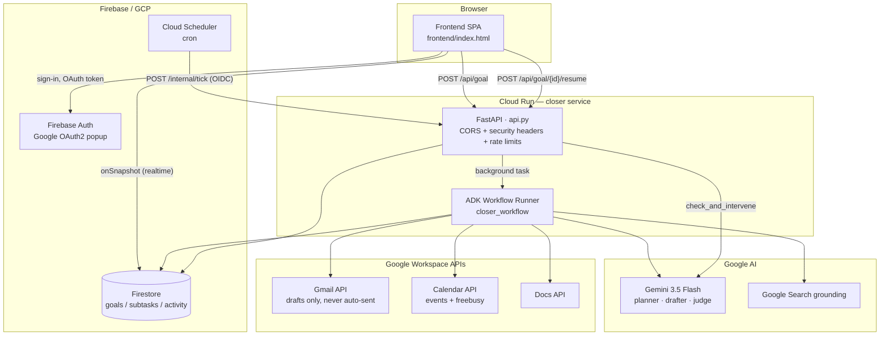
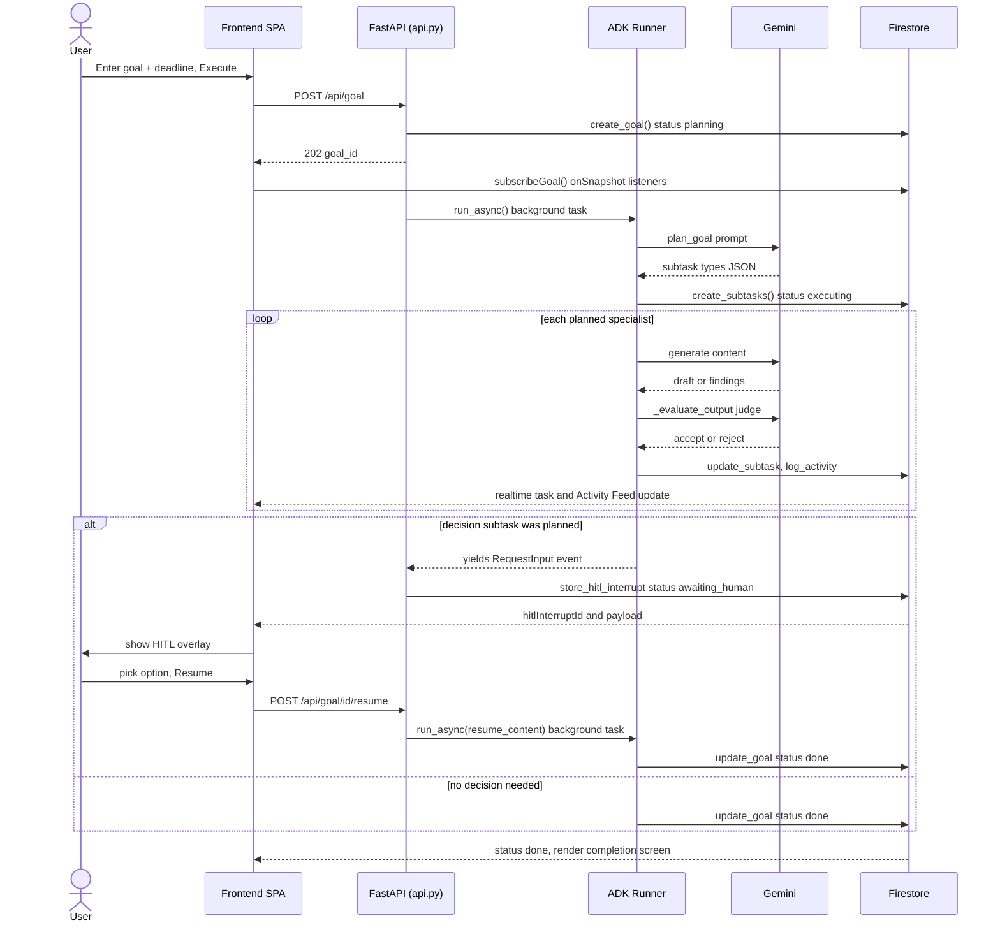
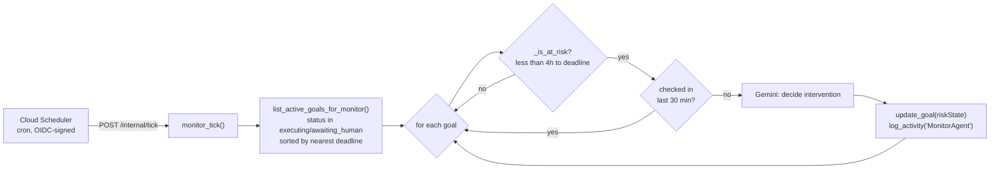
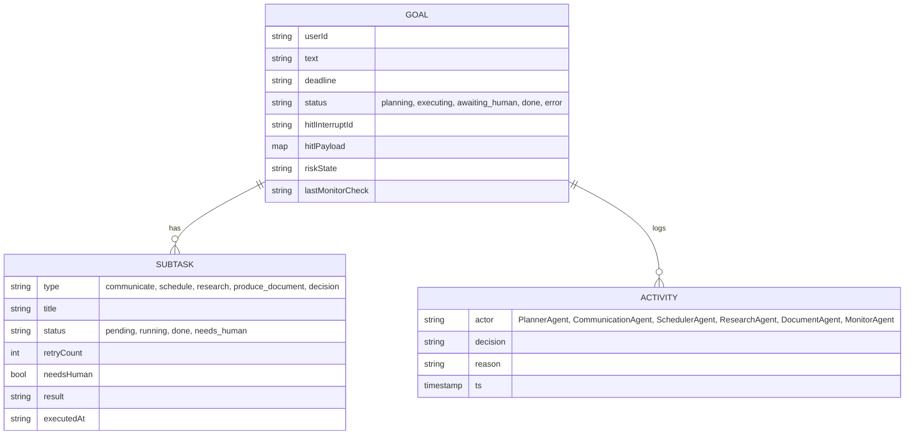

# Closer

**Your deadlines, executed.** An autonomous agent that turns a plain-English goal + deadline into real, completed work — drafted emails, calendar-blocked prep time, researched findings, generated documents — pausing only for the decisions that genuinely need a human.

Built for the **"Last-Minute Life Saver"** hackathon track. Python, FastAPI, Google ADK 2.x.


**Live demo:** currently offline. Deploy it yourself to Cloud Run with the steps under [Deployment](#deployment).

---

## Table of Contents

- [What it does](#what-it-does)
- [Why it's more than a chatbot with tools](#why-its-more-than-a-chatbot-with-tools)
- [Architecture](#architecture)
- [Agent workflow](#agent-workflow)
- [Request lifecycle](#request-lifecycle)
- [Proactive monitor](#proactive-monitor)
- [Data model](#data-model)
- [Tech stack](#tech-stack)
- [Project structure](#project-structure)
- [Getting started](#getting-started)
- [Configuration](#configuration)
- [API reference](#api-reference)
- [Testing](#testing)
- [Deployment](#deployment)
- [Security](#security)
- [Known limitations](#known-limitations)
- [License](#license)

---

## What it does

You type: *"Draft a thank-you email to the design team and schedule a 30-minute retro before Friday."* Closer:

1. **Plans.** Gemini reads the goal and decides which of five capabilities apply. Not a fixed checklist every time.
2. **Executes.** Dispatches only the specialists it needs: drafts a Gmail message, finds real free calendar time, researches live information, generates a Google Doc.
3. **Self-reviews.** A second Gemini call grades every specialist's output before it's accepted. A rejection triggers an automatic retry with the rejection reason fed back in.
4. **Pauses for judgment calls.** If the goal needs a human decision, the workflow interrupts, surfaces a decision card in the UI, and resumes exactly where it left off once you answer.
5. **Watches the clock.** A separate scheduled sweep re-checks in-flight goals and intervenes autonomously when a deadline closes in.

Everything streams to the browser in real time over Firestore listeners — no polling.

## Why it's more than a chatbot with tools

- **Dynamic planning, not a fixed pipeline.** `plan_goal` asks Gemini which of `communicate / schedule / research / produce_document / decision` apply to *this* goal, 1–6 subtasks, capped and validated (`agent/nodes.py:_build_subtasks_from_parsed`). A goal that only needs an email produces one subtask; a complex one produces up to six.
- **Every specialist self-skips.** Each node checks `_find_subtask(ctx.state["subtasks"], "<type>")` and returns immediately if the planner didn't ask for it — dynamic dispatch without needing ADK-level conditional graph branching.
- **Real evaluator-optimizer loop, not a scripted failure.** `_evaluate_output` is a second, independent Gemini call acting as judge. A rejection raises `OutputQualityError`, which ADK's native `RetryConfig` catches (`max_attempts=2`) to regenerate the output — this is genuine self-correction, not a canned "attempt 1 always fails" demo.
- **Deadline arithmetic is computed, not guessed.** LLMs hallucinate weekdays; `_draft_email_content` computes the deadline's actual weekday with `datetime.strftime('%A')` and constrains the prompt to it.
- **Calendar scheduling respects reality.** `find_free_slot` merges overlapping Google Calendar `freebusy.query` windows and walks backward from the deadline to find a genuinely open block — never a blind double-booking.
- **A monitor that runs outside the agent session.** `agent/monitor.py` is a plain async function triggered by Cloud Scheduler, deliberately outside the ADK `Runner`/session lifecycle so it can never re-enter a paused HITL workflow.

## Architecture



- **One Cloud Run service** serves the static frontend, the JSON API, and the internal monitor endpoint. `min-instances=1` keeps it a single deployable unit — in-process HITL state survives between requests.
- **Firestore is the source of truth for UI state.** The backend never pushes to the browser. It writes to Firestore; the frontend's `onSnapshot` listeners do the rest.
- **OAuth access tokens are minted client-side** by Firebase's Google popup and passed to the backend per request (`access_token` field). The backend holds no long-lived Google credentials of its own.

## Agent workflow

The workflow graph (`agent/workflow.py`) is a single ADK `Workflow` with one edge chain — dynamism comes from every specialist self-skipping, not from branching the graph itself:

```mermaid
flowchart TD
    START(["Goal submitted"]) --> PLAN["plan_goal<br/>Gemini → 1-6 typed subtasks"]

    PLAN --> C1{"communicate<br/>planned?"}
    C1 -- no --> C2
    C1 -- yes --> DRAFT["draft_email<br/>Gemini drafts subject+body<br/>weekday computed, not guessed"]
    DRAFT --> J1{"_evaluate_output<br/>Gemini judge"}
    J1 -- "reject → OutputQualityError" --> DRAFT
    J1 -- accept --> GMAIL["Gmail: create draft<br/>(never auto-sent)"]
    GMAIL --> C2

    C2{"schedule<br/>planned?"}
    C2 -- no --> C3
    C2 -- yes --> SLOT["create_calendar_event<br/>freebusy.query → find_free_slot"]
    SLOT --> C3

    C3{"research<br/>planned?"}
    C3 -- no --> C4
    C3 -- yes --> RES["research_topic<br/>Gemini + Google Search grounding"]
    RES --> J2{"_evaluate_output"}
    J2 -- reject --> RES
    J2 -- accept --> C4

    C4{"produce_document<br/>planned?"}
    C4 -- no --> C5
    C4 -- yes --> DOC["produce_document<br/>Gemini writes content"]
    DOC --> J3{"_evaluate_output"}
    J3 -- reject --> DOC
    J3 -- accept --> GDOC["Docs API: create document"]
    GDOC --> C5

    C5{"decision<br/>planned?"}
    C5 -- no --> DONE(["goal.status = done"])
    C5 -- yes --> HITL["request_human_decision<br/>yields RequestInput → workflow pauses"]
    HITL -. "human resumes via POST /resume" .-> RESUME["record choice<br/>goal.status = done"]
    RESUME --> DONE
```



Retry-eligible nodes (`draft_email`, `research_topic`, `produce_document`) run under ADK's `RetryConfig(max_attempts=2, exceptions=[OutputQualityError, EmailValidationError])` — a rejection is a real state transition the engine handles natively, not application-level retry logic.

## Request lifecycle

End-to-end sequence for a goal that includes both an email and a human decision:



## Proactive monitor

Runs entirely outside the ADK session lifecycle — a plain scheduled sweep, so it can never collide with a paused HITL workflow:



`/internal/tick` is gated by Cloud Run IAM (`roles/run.invoker` + OIDC) and, optionally, a shared `X-Tick-Secret` header (`MONITOR_TICK_SECRET`) since the service also serves public traffic on the same origin.

## Data model



Firestore security rules (`firestore.rules`) gate every read by `resource.data.userId == request.auth.uid`; all writes go through the Admin SDK server-side (`allow write: if false` client-side).

## Tech stack

| Layer | Choice | Why |
|---|---|---|
| Agent runtime | Google ADK 2.3.0 (`google.adk.workflow`) | Native `FunctionNode` graph, `RetryConfig`, and async-generator HITL interrupts — no hand-rolled state machine |
| LLM | Gemini 3.5 Flash (`google-genai` 2.10) | Planning, drafting, judging, and Google Search grounding via one client |
| API | FastAPI 0.138 + Uvicorn | Async-native, matches ADK's async runner |
| Rate limiting | slowapi | `5/min` on goal creation, `10/min` on resume |
| Realtime state | Cloud Firestore (async client) | Security-rule-gated reads, no custom WebSocket layer needed |
| Auth | Firebase Auth (Google OAuth2 popup) | Short-lived access token carries Gmail/Calendar scopes to the backend per request |
| Frontend | Single-file HTML + Tailwind (CDN) + vanilla JS | No build step — matches the "ship fast" hackathon constraint |
| Logging | structlog | JSON in production, pretty-printed locally |
| CI | GitHub Actions | `ruff check` then `pyright` then `pytest` |
| Deploy | Cloud Build to Cloud Run | Lint-gated Docker build, `min-instances=1` |
| Scheduling | Cloud Scheduler to `/internal/tick` | OIDC-authenticated, outside the agent session lifecycle |

## Project structure

```
closer/
├── api.py                    # FastAPI app: routes, CORS, security headers, background tasks
├── main.py                   # Local dev entrypoint (uvicorn --reload)
├── config.py                 # Startup-validated env config — import cfg, never os.environ directly
├── logger.py                 # structlog setup (JSON prod / pretty local)
│
├── agent/
│   ├── workflow.py           # ADK Workflow graph definition + CloserState schema
│   ├── nodes.py               # All FunctionNode implementations (planner + 5 specialists)
│   ├── monitor.py             # Proactive deadline-risk sweep (outside ADK session lifecycle)
│   └── errors.py              # OutputQualityError, EmailValidationError
│
├── tools/
│   ├── firestore_client.py    # Async Firestore helpers (goals/subtasks/activity)
│   ├── gmail_client.py        # Gmail drafts (create_draft) + send (unused by default)
│   ├── calendar_client.py     # Event creation + freebusy-aware find_free_slot
│   ├── docs_client.py         # Google Docs artifact creation
│   └── time_utils.py          # Timezone-safe deadline parsing (shared by monitor + Firestore)
│
├── frontend/
│   └── index.html             # Single-file SPA: landing, workspace, HITL overlay, Activity Feed
│
├── tests/                     # 58 tests — pytest + pytest-asyncio
├── firestore.rules            # Per-user read rules for goals/subtasks/activity
├── firebase.json              # Points Firebase CLI at firestore.rules
├── Dockerfile                 # Non-root user, slim Python 3.12 base
├── cloudbuild.yaml            # Lint → build → push → deploy to Cloud Run
└── .github/
    ├── workflows/ci.yml       # ruff → pyright → pytest on push/PR
    └── dependabot.yml         # Weekly pip + Docker update PRs
```

## Getting started

### Prerequisites

- Python 3.12+
- A GCP project with **Firestore** (native mode) enabled
- A **Gemini API key** ([Google AI Studio](https://aistudio.google.com/))
- A **Firebase** web app config (for Auth + client-side Firestore SDK)
- A **Google OAuth 2.0 Client ID** with Gmail, Calendar, and (optionally) Docs scopes enabled

### Local setup

```bash
git clone https://github.com/G26karthik/Closer.git
cd Closer/closer
pip install -r requirements.txt
cp .env.example .env
# fill in GEMINI_API_KEY, FIRESTORE_PROJECT_ID, and the Firebase/OAuth values

# Google Cloud credentials for the local Firestore client:
gcloud auth application-default login

python main.py
# -> http://localhost:8080
```

### Run tests

```bash
pytest                            # 58 tests
ruff check .                      # lint
pyright --pythonversion 3.12 .    # type check (dev-only, not in requirements.txt)
```

## Configuration

All environment variables are validated at import time in `config.py` — the app refuses to start rather than fail on first request. See [`.env.example`](.env.example) for the full annotated list. Highlights:

| Variable | Required | Purpose |
|---|---|---|
| `GEMINI_API_KEY` | Yes | Planning, drafting, judging, research |
| `FIRESTORE_PROJECT_ID` | Yes | Firestore client + security rules target |
| `GOOGLE_CLIENT_ID` / `GOOGLE_CLIENT_SECRET` | Optional | Frontend OAuth consent screen |
| `FIREBASE_API_KEY` / `FIREBASE_AUTH_DOMAIN` | Optional | Firebase Auth + client Firestore SDK |
| `CLOUD_RUN_SERVICE_URL` | Optional | Scopes CORS to this exact origin in production |
| `MONITOR_TICK_SECRET` | Optional | Extra shared-secret gate on `/internal/tick` beyond Cloud Run IAM |

## API reference

| Method | Path | Purpose |
|---|---|---|
| `GET` | `/health` | Liveness probe |
| `GET` | `/` | Serves the SPA with runtime Firebase/OAuth config injected |
| `POST` | `/api/goal` | Create a goal, kick off the workflow as a background task — rate-limited 5/min |
| `POST` | `/api/goal/{goal_id}/resume` | Submit a pending HITL decision, resume the paused workflow — rate-limited 10/min |
| `POST` | `/internal/tick` | Cloud Scheduler target — sweeps at-risk goals via `check_and_intervene` |

## Testing

58 tests across planner subtask validation, the evaluator judge (accept/reject/malformed-JSON fail-open), calendar freebusy slot-finding (including overlapping and malformed busy windows), Firestore activity logging, monitor risk/dedup logic, deadline timezone normalization, and HITL resume handling.

```bash
pytest -v
```

CI (`.github/workflows/ci.yml`) runs `ruff check` then `pyright` then `pytest` on every push and PR to `main`.

## Deployment

Single command builds, lints, and deploys via `cloudbuild.yaml`:

```bash
gcloud builds submit --config=cloudbuild.yaml \
  --substitutions=_GEMINI_API_KEY=...,_GOOGLE_CLIENT_ID=...,_GOOGLE_CLIENT_SECRET=...,_FIREBASE_API_KEY=...,_CLOUD_RUN_SERVICE_URL=... \
  .
```

Pipeline: `ruff check .` (fast-fail) → Docker build → push to GCR → `gcloud run deploy` (`us-central1`, `min-instances=1`, `--allow-unauthenticated`).

To enable the proactive monitor in production:

```bash
gcloud iam service-accounts create scheduler-invoker
gcloud run services add-iam-policy-binding closer \
  --member=serviceAccount:scheduler-invoker@PROJECT.iam.gserviceaccount.com \
  --role=roles/run.invoker --region=us-central1
gcloud scheduler jobs create http closer-tick \
  --uri=https://<your-cloud-run-url>/internal/tick \
  --http-method=POST \
  --oidc-service-account-email=scheduler-invoker@PROJECT.iam.gserviceaccount.com \
  --oidc-token-audience=https://<your-cloud-run-url> \
  --schedule="*/15 * * * *"
```

Deploy Firestore rules separately: `firebase deploy --only firestore:rules`.

## Security

- **CORS** scoped to `CLOUD_RUN_SERVICE_URL` in production (falls back to `*` only when that var is unset, e.g. local dev).
- **Security headers** on every response: `Cross-Origin-Opener-Policy`, `X-Content-Type-Options: nosniff`, `X-Frame-Options: DENY`, `Referrer-Policy`, and HSTS on HTTPS.
- **Rate limiting** via `slowapi` on both mutating endpoints.
- **Firestore security rules** gate every client read by `userId`; all writes are server-side only (Admin SDK, rules deny client writes outright).
- **Non-root Docker user**; `.dockerignore` keeps `.env` and credentials out of the image.
- **`/internal/tick`** is IAM-gated (Cloud Run `roles/run.invoker`) plus an optional shared-secret header, since the endpoint lives on the same public-facing service as the user-facing API.
- **Gmail is draft-only by default** — `draft_email` calls `create_draft`, never `send_email`; nothing leaves the user's account without them reviewing it first.

## Known limitations

- **No OAuth silent refresh.** The frontend caches the Google access token in `sessionStorage`; when it expires mid-session the user must sign out/in again rather than the app refreshing transparently.
- **HITL state is process-local** (`api.py:_pending_hitl`). Safe under `min-instances=1`; would need to move to Firestore before horizontal scale-out.
- **Frontend OAuth scope request is narrower than backend usage.** `signIn()` currently requests only `gmail.compose` and `calendar.events`; `.env.example` documents `calendar.freebusy` and `documents` as required for the scheduling and document specialists — these aren't yet added to the sign-in popup's scope list.
- **HITL wiring uses a private ADK module** (`google.adk.workflow.utils._workflow_hitl_utils`) since the public API surface for request/response interrupts wasn't stable at time of writing — pin the exact `google-adk` version if forking.
- **`requirements.txt` uses `>=` ranges**, not a lockfile — reproducible builds would need `pip freeze` pinning.
- **CORS's fallback wildcard** (`*`) only applies when `CLOUD_RUN_SERVICE_URL` is unset; don't unset it in a real multi-origin deployment.

## License

No license file is currently included in this repository — all rights reserved by default. Add a `LICENSE` file before treating this as open source.
